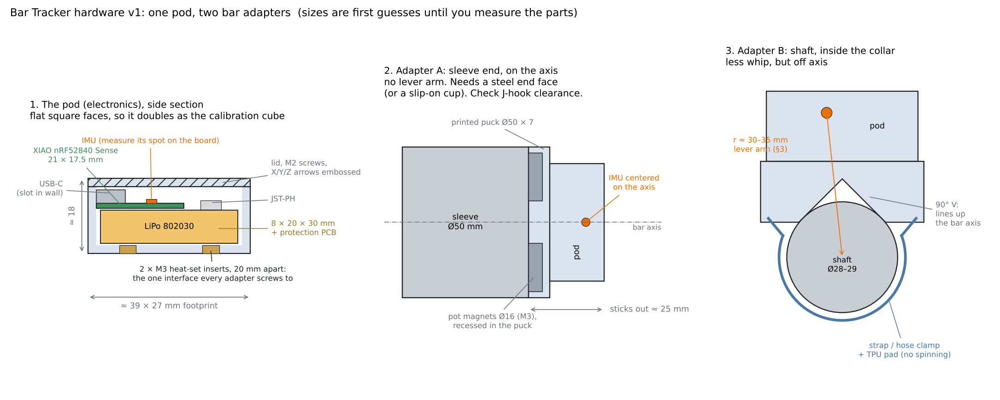
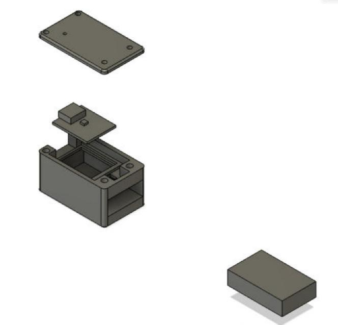

# Enclosure and mounts, v1 (phases 1 to 3)

*(Superseded 10-30, the first concept sketch: its battery, IMU spot and JST-PH box. The pod as
printed is pod_v1 below, with the battery soldered to the pads, D38.)*

One **pod** holds the electronics. Small **adapters** hold the pod on the bar. Every
adapter screws to the same two holes on the pod, so one pod tests both mount spots in
phase 2 (decision O3) and nothing gets redesigned until the final enclosure in 4.4.
All sizes below are first guesses from datasheets. Measure the real parts before
printing anything that has to fit.

## The pod

**Inside, bottom to top:** LiPo, then the XIAO above it, component side up.

- XIAO on top keeps its Bluetooth antenna away from the steel bar (a steel bar right
  next to the antenna eats range), keeps the USB-C port and the LEDs reachable, and
  puts the IMU at a known height.
- LiPo underneath, in its own pocket with ~0.5 mm clearance per side plus a strip of
  foam tape. It must not move, rub on screw tips, or get pressed by the lid.

**Size:** about 39 × 27 × 18 mm outside, 25 to 30 g with the battery.

**Features:**

- **Six flat, square outer faces.** Then the pod itself is the calibration cube for the
  6-position calibration and the full-turn gyro test (roadmap 1.3). Calibrating the
  assembled pod also catches the board sitting slightly crooked in the case. Chamfer the
  edges, don't round the faces.
- **XIAO held square to the walls:** a pocket or two ledges the board drops into, so its
  axes line up with the case faces. Emboss the X/Y/Z arrows on the lid, copied from the
  IMU's axes (the LSM6DS3TR-C datasheet shows them; check against a reading on each face).
- **USB-C slot** in the end wall, so charging and flashing work with the lid on.
- **LED window:** a 1 mm thin spot or a small hole over the XIAO's LEDs (charge LED +
  RGB).
- **Reset pinhole** over the reset button (double-tap enters the bootloader).
- **JST-PH socket** wired to the XIAO's battery pads (underside of the board), with a
  little channel so the wires don't get pinched. *(Superseded 10-30: no socket. The leads are
  soldered straight to the BAT pads, D38; see the assembly checklist.)*
- **Lid:** 4 × M2 screws into heat-set inserts (or self-tapping M2 into plain holes for
  the first print).
- **Adapter interface:** 2 × M3 heat-set inserts in the floor, 20 mm apart, centered
  under the IMU along the long axis. Every adapter is just a plate with two M3 holes.
- **Power:** the XIAO has no switch. For v1, either unplug the JST to turn it off, or
  put a mini slide switch in the battery + lead (then it can't charge while switched
  off). Deep sleep with wake-on-motion is the phase 4 answer (hardware/README.md).
  *(Superseded 10-30: no switch since 10-19, and no JST: the 10-21 print has no room for a mated
  pair, so the battery is soldered straight to the pads (D38). Off is the deep sleep (D26); there's
  no hard off short of desoldering, and unplugging USB doesn't power-cycle the board. See the
  assembly checklist.)*

### XIAO axes (measured 2026-10-18, for the lid arrows)

Gravity on each face of a bare XIAO Sense running `imu_serial` (files
`analysis/data/bar-xiao-2026-10-18-*-axis-*.csv`):

| board pose | axis pointing up |
|---|---|
| USB-C end up / down | -x / +x |
| D0-D6 pin edge up | -y |
| 5V/GND/3V3 pin edge up | +y |
| chip side up / down | +z / -z |

So **+x runs from the USB-C end toward the far end** (the pod's long axis, same way as
x in `pod_v1.py`), **+y points at the 5V/GND/3V3 edge**, **+z comes out of the chip
side** (out of the lid). Arrows on the lid: X along the length away from the USB-C slot,
Y toward the 5V/GND/3V3 side, Z as a dot (out of the lid). Recheck once the board sits
in the printed pod.

## Adapter A: sleeve end, on the bar axis

- **Built (2026-10-19, `Adapter A puck` in pod_v1, see the end of this file).** Original idea:
- **Puck:** Ø50 × 7 mm disc, 2 or 3 pot magnets (Ø16, countersunk M3) recessed flush in
  the side that touches the bar, pod screwed to the outside face with the **IMU on the
  bar axis**. On the axis there's no lever arm (algorithm.md §3).
- **Only works on a steel end face.** Check your gym's bars with a fridge magnet first:
  some end caps are aluminum or plastic, some have a raised logo or a bolt.
- **Plan B for non-steel ends:** a slip-on cup, inner Ø = measured sleeve Ø + 0.6 mm, 15
  to 20 mm deep, slit on one side and tightened with a small hose clamp, TPU liner
  inside. Needs that much bare sleeve past the plates and collar.
- Sticks out ~25 mm past the sleeve end. Check J-hooks, safeties and the wall.
- The sleeve spins with the plates. That's fine on the axis: the gyro sees it, the
  position doesn't change.

## Adapter B: shaft, just inside the inner collar

- **Saddle:** a block with a 90° V-groove underneath that sits on the shaft. A V on a
  round bar centers itself, so the bar's axis direction is fixed by the part (bar path
  gets its axis for free, D6). TPU or rubber pad in the V so it can't rotate on the
  knurling.
- **Held by** a 20 mm hook-and-loop strap or a small hose clamp through slots in the
  saddle. Magnets on a round shaft only touch along a line and hold poorly; don't trust
  them here.
- **IMU ends up 30 to 35 mm off the axis.** That's the `r` for the lever-arm fix (§3).
  The CAD tells you `r` exactly, so write it down.
- Shaft diameters differ: 28 mm (men's Olympic), 29 mm (power bar), 27 mm (deadlift
  bar), 25 mm (women's). The V handles all of them, but `r` changes, so note which bar.

## Print list

| part | needed for | material | notes |
|---|---|---|---|
| Pod case + lid | 1.3 (as the calibration cube), 1.5, 2.1 | PETG (PLA is fine for a fit-test print) | 4 walls, 30 to 40% infill, floor on the bed |
| Adapter A puck | 2.1 | PETG | magnets glued + screwed in |
| Adapter A slip-on cup | 2.1, only if the end cap isn't steel | PETG + TPU liner | |
| Adapter B saddle | 2.1 | PETG + TPU pad | |
| *Later:* string encoder spool + base | 3.0 (optional) | PETG | see BOM phase 3 |
| *Later:* final enclosure | 4.4 | PETG or tougher | after O3 picks the spot, with the carrier PCB |

For phase 3, stick the printed AprilTag on the pod's flat lid. No extra part.

## Measure before you design (calipers)

- XIAO: length, width, board thickness, height of the tallest part (USB-C), and **where
  the IMU chip sits** (distance from two board edges). Where the antenna is.
- LiPo: length × width × thickness *including* the protection board and where the wires
  come out. Pouch cells vary by a millimeter or two between sellers.
- JST-PH plug and socket bodies. *(Superseded 10-30: no JST in the pod, D38.)*
- Pot magnets and heat-set inserts: check the insert's recommended hole size.
- The gym bar: sleeve Ø, end face (flat? steel? raised cap?), shaft Ø where the saddle
  goes, how much bare sleeve is left past the collar with plates on, J-hook clearance.

## Extra parts (on top of BOM phase 1 and 2)

| item | for |
|---|---|
| 5 short M3 heat-set inserts (x 4); 2 × M3 × 10 socket head; 3 × M3 × 8 countersunk | adapter interface (pod to puck); Adapter A's magnets |
| M2 heat-set inserts (or self-tapping M2) + screws | lid |
| Pot magnets Ø16 mm, countersunk M3, 3 or 4 | Adapter A |
| Hook-and-loop strap 20 mm wide, or 2 small hose clamps | Adapter B |
| TPU filament, or a scrap of rubber sheet | anti-slip pads |
| Thin foam tape | battery pocket |
| *Optional:* mini slide switch (SS12D00 type) *(superseded 10-30: no switch since 10-19, and the battery is soldered to the pads, D38)* | power |

## Assembly checklist (2026-10-30, the parts arrived)

Print check first: the **10-21 export** is the current design: `hardware/enclosure/stl/`
(`pod_case.stl`, `pod_lid.stl`, `puck_a.stl`, laid print-side down by `stl_orient.py` on 10-30;
Fusion's `Pod case.stl` and the others beside the folder are the same parts as modeled). The case
is **41.8 mm** long. A 40.8 mm case is from the `stl/` files before 10-30 (no lid countersinks,
old insert spots): reprint it.

What the print was sized for (pod_v1.py's parameters), so check each part against it:

| part | the print expects | why it matters |
|---|---|---|
| lid inserts, 4 | M2, for a 3.2 mm hole 4 mm deep (M2 x 3) | a longer insert won't seat |
| lid screws, 4 | M2 countersunk (flat head, ISO 7046), 5 mm long | the lid is 2 mm, so x 5 leaves 3 mm in the insert; x 6 can bottom out in the 4 mm hole |
| floor inserts, 2 | M3 **short** (x 4), for a 4.0 mm hole 4.5 mm deep | a standard 5.7 mm M3 insert goes through the floor into the battery |
| magnets, 3 | Ø16 x 4.5 mm pot magnets, countersunk M3 | pockets are Ø16.4 |
| magnet inserts + screws | 3 more short M3 inserts; M3 x 8 countersunk | |
| puck to pod | 2 x M3 x 10 socket head | 6.8 mm through the puck, 3.2 mm into the pod's insert |
| battery | at most 30.5 x 19.7 x 7.6 mm incl. the protection board, wires out of one end (the PL 602030) | pocket + 0.4 mm a side |
| battery leads | soldered straight to the BAT pads under the board (decided 10-30, D38) | no room for a JST-PH pair (below) |

**Battery wiring (decided 10-30: soldered straight to the BAT pads, D38).** The cell's leads leave
its far end under the tray, run back over the cell in the 2 mm `batt_gap` and up through the window
under the board to the BAT pads: that path is in the print. A mated JST-PH pair isn't. The free
space above the tray at the far end (~10 x 8.5 mm, only 4.7 mm tall; a mated PH pair is ~4.5 mm
thick) has no way in for the leads: the board covers the window, and the tray's far end leaves a
0.5 mm slot the lid's end wall would pinch them in. The tray's wire hole went with the switch
(10-19, 0f34569). So the plug comes off. *(Not taken: reprint the case with a wire hole in the
tray past the fence, about 4 x 5 mm, where pod_v1 had one until 10-19.)*

What a soldered cell changes:
- **No hard off.** Off is the deep sleep (D26). The lid-down sleep wakes on any bump, so for a
  bag or a shelf use the IMU-off sleep, which only USB or the reset pinhole wakes: `o` typed
  into a serial terminal that holds the port open (the Arduino Serial Monitor), or the phone's
  SLEEP mode 1 (`barDebug.podSleep(1)` from the app's devtools console, during a running pod
  session; no button yet).
- **Unplugging USB should no longer be a power cycle:** by Seeed's schematic the cell takes over
  the 3.3 V regulator as VBUS goes (not bench-checked yet, D38). The recovery is the reset
  pinhole: a pin reset, which also clears a running watchdog.
- **Every USB session charges the cell** (unless it's full), so the P0.14 rule is always live:
  only builds from `python firmware/flash.py` (pod or imu_serial) go on this board, no Seeed
  example sketches and no raw arduino-cli upload.
- **imu_serial has no sleep and no low-battery cutoff,** and neither has the pod firmware stuck at
  "IMU not found" on USB: unplugged, both run the cell down to the protection board's trip. Flash
  the pod firmware back before unplugging imu_serial.
- **The 3.30 V cutoff only runs while the pod is awake.** Charge it when the app says battery
  low, and charge it before storing it. (Estimates from datasheets, not measured: about 16 uA
  asleep with motion wake, 7 uA with the IMU off, so a full cell lasts over a year asleep; from
  the cutoff only weeks.)

Inserts: set them with a soldering iron (the insert maker's temperature for your filament),
straight and flush, and let them cool before any screw goes in.

**Soldering the battery, in order.** The board (21 x 17.8 mm) and the cell can't pass through the
tray's window (19.4 x 16.2), but the JST plug can. So the cell goes into the case with its plug
still on, the leads come up through the window, and the board is soldered while it's held just
outside the case, then folded in.
1. Set all 6 heat-set inserts first and let the case cool. None may poke into the battery pocket.
   No iron on the case once the cell is in.
2. Flash the pod firmware (`python firmware/flash.py`), then unplug USB. It stays out until the
   checks below.
3. Find the pads with the meter on continuity: BAT- (8.26 mm from the USB-C edge) beeps to the
   USB-C shell or the GND edge pad, BAT+ (10.16 mm, the one farther from the USB-C end) doesn't.
   They're 1.9 mm apart, right under the IMU on the other side. (A Sense, not a Sense Plus: the
   Plus moved them.)
4. Find the cell's + lead with the meter on DC volts at the plug's contacts and flag it with tape
   near the cell (the plug end gets cut off). Don't go by wire color or the plug's pin order (it
   varies by seller). It should read 3.0 to 4.2 V; less, or nothing, means a tripped or dead cell:
   don't fit it. Write the voltage down.
5. Foam first, while the cell is out: the cell has 2.4 to 4 mm of play under the tray. A pad on
   the cell's top, on the 5V half under the solid far part of the tray, thick enough to just touch
   it (the leads and their slack take the D0-D6 half). Not under the window: there it presses on
   the board. Not checked in a fit.
6. Thread the plug in at the far end, under the tray and up through the window. Slide the cell in
   after it, leads last, with its lead corner on the D0-D6 side, and push it to the USB-end wall.
7. Fold the leads flat: up the cell's end, then back over its top along the D0-D6 wall. At the
   far end nothing may sit above the tray or past its edge: the lid's end wall comes down 0.5 mm
   past it and pinches anything there. Lead them out through the USB-C slot (open at the top) and
   test-fit the lid without screws.
8. Mark each lead 15 mm above the rim, held straight up over its pad's spot (BAT+ about 10.6 mm
   and BAT- 8.7 mm from the inside of the USB-end wall, both about 5.8 mm from the D0-D6 wall).
   That needs about 55 mm of lead from the cell and leaves about 20 mm of slack inside. If the
   leads are shorter, cut right at the plug and hold the board closer; don't splice.
9. **Cut ONE lead at its mark and tape its cell-side end before cutting the other.** Cutting both
   at once shorts the cell through the cutters.
10. Strip about 1.5 mm off each and tin both. Check again with the meter which end is +, then tape
    the - end.
11. Flux and tin both pads with a small bump: the largest tip that fits one pad (a 1 to 1.5 mm
    chisel heats the ground pad faster than a fine cone, so less heat soaks into the IMU), at your
    usual temperature (about 330 C leaded, 350 C lead-free), under 3 s per touch, cool between.
    Then continuity across the two pads: no beep.
12. Hold the board pads-up just outside the case's D0-D6 wall, that edge toward the case and the
    USB-C end toward the case's USB end. Cover the helping hand's jaws with Kapton or tape: a bare
    jaw across the edge pads shorts 3V3 to GND (and 5V, once USB goes in).
13. Solder + to BAT+ first. Then untape - and solder it to BAT-, keeping its tip clear of the live
    BAT+ joint. The board boots now: one short green blink (the LEDs face down). Held still and
    near flat pads-up is the lid-down gesture, so about 6 s later it blinks blue 3 times and
    sleeps. Either means it runs from the cell.
14. Meter the BAT+ joint against the USB-C shell or the GND pad, not across the two joints (a
    slipped probe there is a dead short). It must read the voltage from step 4. Negative or near 0
    means reversed or bridged: desolder, BAT- first.
15. Kapton over each joint, then one piece across both. A dab of hot glue (or a Kapton strip)
    holds the leads to the board 1 to 2 mm from the joints, at least 1.5 mm from the board's
    edges (the ledge is under them).
16. Turn the board in like a page about its D0-D6 edge, pushing the slack down through the window
    as it goes. Lay the slack as one flat loop on the cell under the solid far part of the tray:
    not in the window (it lifts the board, the calibration reference), not in the far-end fold.
17. Press the board flat: USB-C in its slot, on the ledge all round, no rocking (rocking means wire
    under it). Lid on with its 4 screws. A screw that needs force means something's pinched.
    Shake it by your ear: no rattle.
18. Lid up, plug USB in and open the port: `python analysis/log_serial.py COMx --seconds=70
    --name=battery-check` (COMx: the port number changes per board, see the port list). About
    every 30 s: `# battery X.XX V, USB yes, charging yes`. The voltage should be 3.6 to 4.3 V and
    within about 0.15 V of step 4: the reading isn't checked against a meter yet (D38) and the
    chip's ADC is good to a few percent, so it can't show the small rise from charging. "charging
    yes" is what says it charges; "charging no" with a full cell is fine.
19. Calibrate the assembled pod (`python analysis/calib_pod.py COMx`, roadmap 1.3): soldering
    right under the IMU can shift its offsets, and the case's faces are the reference anyway.

To take the cell off later: BAT- first, tape it, then BAT+.

## CAD

Start parametric so measured numbers drop straight in. Suggested user parameters:

| name | value (measured 2026-10-19 unless noted) | what |
|---|---|---|
| `xiao_l`, `xiao_w`, `xiao_t` | 21.0, 17.8, 1.0 mm | XIAO board |
| `xiao_top` | 3.3 mm | tallest part above the board (USB-C) |
| `imu_x`, `imu_y` | 8.89, 4.32 mm (Seeed KiCad) | IMU center from the USB-C edge and the D0-D6 edge |
| `batt_l`, `batt_w`, `batt_t` | 30.5, 19.7, 7.6 mm | LiPo with its protection board |
| `wall`, `floor`, `lid_t` | 2, 2, 2 mm | |
| `fit` | 0.4 mm | clearance per side around parts |
| `m3_insert_d`, `m2_insert_d` | from the insert spec | hole sizes |
| `iface_spacing` | 20 mm | the two M3 inserts |
| `sleeve_d`, `shaft_d` | 50, 28.5 mm | the bar |
| `magnet_d`, `magnet_h` | 16, 4.5 mm | pot magnets |

Two ways to get the model:

- Draw it in Fusion with those as user parameters (Modify → Change Parameters).
- Or have Claude Code on the PC write a **Fusion 360 Python script** that builds it
  (in Fusion: Utilities → Add-Ins → Scripts and Add-Ins, add the script, Run). The
  result is a normal parametric Fusion model you can keep editing by hand.

### Pod v1 script (2026-10-16): `hardware/enclosure/pod_v1/pod_v1.py`

Builds the case + lid as a new parametric design: every size above is a user parameter
(first guesses), plus the extras the model needs. Fusion wants the folder and the script
to share a name, hence `pod_v1/pod_v1.py` + `pod_v1.manifest`. Adapters aren't in it yet.

Changes from the sketch above, and why:

- **The battery slides in from the far end**, through a slot in the end wall, under a
  printed tray. The LiPo (20.5 mm) is wider than the XIAO (17.5 mm), so any ledge that
  holds the board above it blocks a battery dropped in from the top. The tray is the
  XIAO ledge (`ledge_w` under every board edge, a window in the middle for the pads and
  wires) plus a fence that holds the board square. Foam tape keeps the battery put.
- **Thicker floor:** `floor` is `floor_t` (floor() is a Fusion function) and gets
  `iface_extra` = 3.5 mm on top, so the M3 insert holes leave 1 mm under the battery.
  Short M3 x 3 inserts: set `m3_insert_h` = 3 and `iface_extra` = 2.5.
- **USB-C end wall is `end_wall` = 5 mm** so two of the lid screws fit beside the board;
  the other two go in square bosses in the far corners, standing on the tray.
- First guesses give 40.8 x 25.3 x 22.5 mm with the lid (vs. ~39 x 27 x 18 estimated).
- `imu_x/y`, `led_x/y`, `rst_x/y` are placeholders (marked MEASURE): measure from the
  board's USB-end corner, component side up, USB-C pointing left, from the bottom-left
  corner (x to the right, y up).
- **Run in Fusion 2026-10-18:** builds clean (40.8 x 25.3 x 22.5 mm, IMU at 15.9, 12.7 mm from
  the USB-end corner, no failed features). Fusion infers a level/plumb constraint when two
  holes share a coordinate, so the script skips those 3 redundant dimensions and lists them;
  the holes still follow the parameters.
- **Edges (2026-10-18):** R2 fillets on the 4 vertical corners of case and lid (`corner_r`),
  0.6 mm chamfer round the bottom (`bottom_ch`, prints floor-down where a fillet wouldn't),
  0.8 mm fillet round the lid top (`lid_r`). Every face stays flat for calibration.
- **Battery wires (2026-10-18):** `batt_gap` = 2 mm between the battery and the tray. Before it
  there was 0.4 mm over the cell: no room for foam tape, and no way for the wires (out of
  the cell's far end) to reach the BAT pads under the board. Now foam + 2 x 28 AWG run
  over the cell to the window under the board, and the solder joints hang into it.
  Pod 40.8 x 25.3 x 24.5 mm with the lid. Inspect > Interference with the stand-ins: none.
  Measure where the BAT pads really are before soldering.
- **Stand-ins and exploded view (2026-10-18):** the script also adds `XIAO (stand-in)`
  (board, USB-C block, IMU marker) and `LiPo (stand-in)`, each its own component, so
  Inspect > Interference can catch a real size that won't fit. Exploded view made in the
  Animation workspace (lid up 6 cm, board up 3 cm, battery out the far end 6 cm; redone with the
  lid end wall and switch cradle):
  
- **Battery retention (2026-10-18, replaces the loose door):** the case's far end is open full
  height and the **lid has an end wall** that closes it, so the 4 lid screws hold the battery
  in (`plug_fit` clearance round it). The switch lever goes through a slot in that wall, open
  at the bottom so it slides down over the lever, with the recess round the lever on it.
- **USB-C relief:** the end wall is 5 mm (for the lid screws), too thick for most plugs'
  overmolds. Outside the slot there's now a 13 mm wide relief leaving 1.5 mm of wall where
  the plug passes (overmolds up to 13 x 7.4 mm), continued into the lid's underside.
- **Power switch:** cradle for an SS12D00-type mini slide switch at the far end, between the
  board and the far screw bosses; it drops in from the top, the lever goes out through a slot
  in the end wall into a 1 mm recess, so the tip stays inside the face (`sw_*` parameters,
  MEASURE the switch). Battery + runs up the wire hole to the switch and back down to BAT+.
  *(Removed 10-19, see "No switch" below.)*
- **USB-C plug vs lid:** a 6.5 mm overmold reaches 1 mm above the rim, so the lid has a
  hidden pocket underneath at the USB end, open on the end face (0.8 mm of lid left over it).
- Checked in Fusion: builds clean, Inspect > Interference with all parts: none, and changing
  `batt_l` 33 -> 40 mm rebuilds with no errors.
- **Still unknown until the parts and a test print:** every MEASURE size (XIAO, LiPo, IMU/LED/
  reset spots, inserts, switch), whether the 21 mm tray bridge prints clean, whether the LEDs
  show through `led_skin` (set it to 0 for a hole if the filament is opaque), J-hook clearance
  at 24.5 mm tall. Axis arrows wait for the IMU orientation to be confirmed. Adapters next.
- Not modeled yet: embossed X/Y/Z arrows, the JST socket (it fits in the
  ~10 x 9 mm space between the fence and the far bosses, over the wire hole).
  *(Superseded 10-30: no JST socket at all. The wire hole went with the switch on 10-19, so the
  leads couldn't reach that space, and the battery is soldered to the pads (D38).)*

### Measured parts (2026-10-19, calipers in inches, converted)

- **LiPo:** PL 602030, 3.7 V, 400 mAh (nominal 6.0 x 20 x 30 mm). Measured 30.5 long incl.
  the protection board, 19.7 wide, 7.6 thick over the protection board (cell ~6.0). Wires
  leave the protection-board end near one corner. Not the Adafruit #3898 the BOM lists.
- **XIAO nRF52840 Sense:** 21.0 x 17.8 mm, board 1.0 thick. From the board's bottom face:
  radio can top 2.8, USB-C top 4.3 (so `xiao_top` 3.3). USB-C sticks out 1.3 past the
  board edge. USB-C up and parts facing you: D0-D6 on the left edge, 5V/GND/3V3/D10-D7 on
  the right. In the CAD (x away from USB-C, z up) the D0-D6 edge is the low-y side, and it
  matches the IMU axes above (+y toward the 5V edge).
- **USB-C cable overmold:** 11.0 wide x 6.0 thick.
- **IMU position, PROVISIONAL:** the small dark part near the far corner on the 5V/GND/3V3
  side is centered 18.5 from the USB-C end and 13.8 from the D0-D6 edge (4.0 from the 5V
  edge). It has a round port hole, so it may be the **microphone**, not the IMU (the
  LSM6DS3TR-C is a plain 2.5 x 3 mm LGA with no hole). The adapter M3 inserts are centered
  under `imu_x`, so **confirm the IMU position before printing any adapter** (Seeed's
  board drawing, or a tap test: tap right over each chip and watch which one the gyro
  says is the rotation center). The pod itself doesn't depend on it except for where the
  two M3 inserts sit.
- Still guesses: LED and reset positions (`led_*`, `rst_*`), the switch (`sw_*`, none bought
  yet), how far the battery wires stick out (`batt_wire_l` 2.5).

What changed in the model:

- `cav_l` now has `batt_wire_l` = 2.5 mm past the battery's protection-board end: before,
  the cavity was exactly battery + fit, and the 33 mm guess only left wire room by luck.
  With 30.5 + 2.5 the length stays 40.8 mm.
- Width 25.3 -> **24.5 mm** (battery 19.7), height 24.5 -> **23.4 mm** (thinner battery and
  board, lower USB-C). Outside: **40.8 x 24.5 x 23.4 mm** with the lid.
- Narrower case squeezed the far end, so: `boss` 6 -> 5.8 mm (switch pocket fits between),
  `usb_relief_w` 13 -> 12 mm (11.0 plug + 0.5 a side; keeps 1.65 mm of wall to the M2
  inserts), `usb_slot_w` 12.5 -> 11.5, `usb_slot_h` 7 -> 6.6 (6.0 plug; 0.7 mm of lid left
  over the USB pocket). Relief is 6.8 mm tall, centered on the socket.
- The plug's overmold now stops 0.6 mm short of the socket mouth (it sticks out 1.3).
- Adapter M3 inserts moved to x = 13.9 and 33.9 (under the provisional IMU at 23.9).
- Offline check (all parameter expressions + 38 fit checks): all pass.
- Rebuilt in Fusion 2026-10-19 (Quentin ran it): builds fine. Inspect > Interference with the stand-ins not rerun yet.
- **Print files (2026-10-19):** `hardware/enclosure/stl/pod_case.stl` + `pod_lid.stl`, already print-side down (case floor on the bed, lid flipped flat top down). Redo after a model change: run the Fusion script `pod_export` (Scripts and Add-Ins), then `python hardware/enclosure/stl_orient.py` (mm, closed-mesh check). Case 40.8 x 24.5 x 21.4, lid 40.8 x 24.5 x 17.75 (plate + end wall). The tray inside the case spans the battery pocket: short overhangs from the walls plus a ~20 mm bridge, usually fine without supports; if the slicer flags it, support just that.

### Board positions from Seeed's KiCad file (2026-10-19)

From Seeed's XIAO nRF52840 Sense KiCad project (wiki Resources, `Seeed-Studio-XIAO-nRF52840V1.1-KiCad-Project-260105.zip`;
board 20.955 x 17.780). Distances from the USB-C board edge / the D0-D6 edge, in mm:

| part | from USB-C edge | from D0-D6 edge | side |
|---|---|---|---|
| **IMU** (U3, LSM6DS3TR-C) | 8.89 | 4.32 | top |
| microphone (MIC1) | 19.43 | 13.46 | top |
| reset button (K1) | 1.91 | 3.17 | top |
| RGB LED / charge LED | 2.79 / 0.64 | 14.60 | top |
| **BAT+ pad** (BAT0) | 10.16 | 4.44 | bottom |
| **BAT- pad** (GND0) | 8.26 | 4.44 | bottom |
| SWD pads (SWDIO, SWCLK, RESET, GND) | 1.9 to 4.5 | 7.6 to 10.2 | bottom |
| NFC pads | 19.69 | 12.7 / 14.6 | bottom |

- The "IMU" measured with calipers (18.5 / 13.8) was the **microphone**: it matches MIC1 and
  has the sound port. The real IMU is near the USB-C end, so the adapter M3 inserts moved to
  x = 4.3 and 24.3 in the case (IMU at x = 14.3). `imu_*`, `rst_*`, `led_*` now use these.
- **Battery wires:** the BAT pads are under the board, almost under the IMU, over the tray's
  window. So the wires leave the battery's protection-board end (far end), turn up in the
  `batt_wire_l` gap, run forward over the cell in the 2 mm `batt_gap`, and come up through
  the window to the pads. They don't need the tray's wire hole: that was only for routing
  battery + through the switch.

- **No switch (2026-10-19):** removed the switch cradle, its lever slot and recess (case and lid), the `sw_*` parameters, and the tray's wire hole (it was half covered by the cradle, and the wires don't need it: they reach the BAT pads through the window under the board). `boss` back to 6 mm. To turn the pod off, unplug the battery (lid off) *(Superseded 10-30: no JST, the battery is soldered to the pads, D38. Off is the deep sleep; for storage the IMU-off sleep)*. A switch can come back in a v2 if that gets annoying. Offline checks: 31/31 pass. **Rerun pod_v1, then pod_export + stl_orient.py**: the STLs in `stl/` are from before this and before the IMU move. *(Done: the 10-21 export, oriented into `stl/` on 10-30.)*

### Symmetric mount holes + Adapter A puck (2026-10-19)

- The pod's two M3 floor inserts are now **centered on the pod** (x 10.4 and 30.4, y 12.25),
  not under the IMU. The IMU sits 6.11 mm toward the USB-C end and 4.58 mm toward the D0-D6
  side of the pod's center; each adapter offsets its own holes by that, so the IMU still
  lands where the adapter wants it.
- **Puck** (component `Adapter A puck`, body `Puck`): Ø50 (`sleeve_d`) x 10 mm, **centered on
  the IMU**, so on a sleeve end the IMU is on the bar's axis. Bar side: 3 pockets for Ø16 x
  4.5 pot magnets on a 15 mm radius (`mag1..3_x/y`, placed clear of the screw holes), each
  with an M3 heat-set insert under it for the magnet's countersunk screw. Two counterbored
  M3 holes (head 3.2 mm below the bar face) for the screws up into the pod's inserts.
  Walls: 1.8 mm outside the magnets, 1.6 mm magnet to counterbore (geometric limit with this
  hole spacing), 1 mm skin over the inserts. Print it pod-side down (`puck_a.stl` is already
  flipped): pockets open upward, no bridges.
- **Magnets:** 3 x Ø16 mm countersunk neodymium pot magnet, 4.5 mm tall, M3 countersink,
  e.g. supermagnete CSN-ES-16 (about 6.9 kg pull, about 1.4 kg sideways) or Eclipse 16 mm
  M3 (6 to 7.5 kg). Sideways ("displacement") force is ~20% of pull, and that's the one
  that matters on a sleeve end (rack bumps shove the puck along the face): 3 magnets give
  ~4 kg sideways on clean flat steel for a ~60 g pod + puck. A 0.5 mm gap (paint, raised
  logo, rubber) costs a lot of that, so test the bar end with a fridge magnet first and
  keep the puck's bar face clean and flat. Don't torque magnet screws past ~2 Nm (they crack).
- **Hardware:** 3 more M3 heat-set inserts (magnets), 3 x M3 x 8 countersunk (magnets),
  2 x M3 x 10 socket head (pod to puck).

- **Countersunk lid screws (2026-10-19):** the lid holes get a 45 deg countersink (`m2_csk` 0.8, 4.0 mm across) for **M2 x 6 flat-head (ISO 7046) screws**, so the lid top stays a flat calibration face (pan heads stuck up ~1.3 mm). To keep the USB-end countersinks off the lid's 0.8 mm rounded edge, `end_wall` 5 -> 6 mm: pod now **41.8 x 24.5 x 23.4 mm**; the puck's magnets were re-placed for the shifted hole pattern (>= 1.68 mm walls). The script skips the countersink (and says so) if Fusion can't make it. 44/44 offline checks pass. How the lid holds: each screw passes through the lid and threads into a brass heat-set insert in the case (2 in the USB-end wall, 2 in the far bosses); the head clamps the lid down, and the lid's end wall keeps the battery in.
