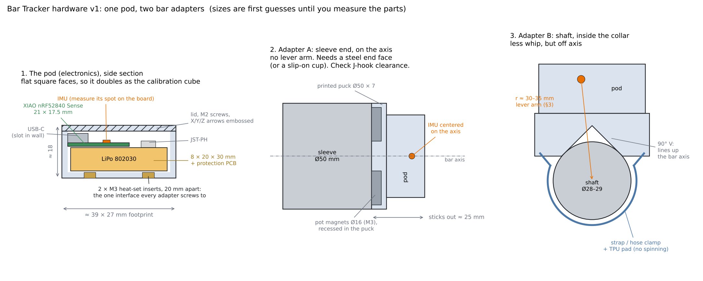
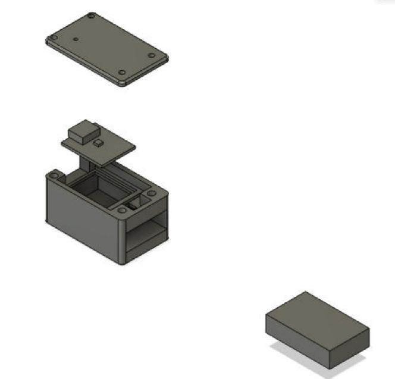

# Enclosure and mounts, v1 (phases 1 to 3)

One **pod** holds the electronics. Small **adapters** hold the pod on the bar. Every
adapter screws to the same two holes on the pod, so one pod tests both mount spots in
phase 2 (decision O3) and nothing gets redesigned until the final enclosure in 4.4.
All sizes below are first guesses from datasheets. Measure the real parts before
printing anything that has to fit.

## The pod

**Inside, bottom to top:** LiPo, then the XIAO above it, component side up.

- XIAO on top keeps its Bluetooth antenna away from the steel bar (a steel bar right
  next to the antenna eats range), keeps the USB-C port and the LEDs reachable, and
  puts the IMU at a known height.
- LiPo underneath, in its own pocket with ~0.5 mm clearance per side plus a strip of
  foam tape. It must not move, rub on screw tips, or get pressed by the lid.

**Size:** about 39 × 27 × 18 mm outside, 25 to 30 g with the battery.

**Features:**

- **Six flat, square outer faces.** Then the pod itself is the calibration cube for the
  6-position calibration and the full-turn gyro test (roadmap 1.3). Calibrating the
  assembled pod also catches the board sitting slightly crooked in the case. Chamfer the
  edges, don't round the faces.
- **XIAO held square to the walls:** a pocket or two ledges the board drops into, so its
  axes line up with the case faces. Emboss the X/Y/Z arrows on the lid, copied from the
  IMU's axes (the LSM6DS3TR-C datasheet shows them; check against a reading on each face).
- **USB-C slot** in the end wall, so charging and flashing work with the lid on.
- **LED window:** a 1 mm thin spot or a small hole over the XIAO's LEDs (charge LED +
  RGB).
- **Reset pinhole** over the reset button (double-tap enters the bootloader).
- **JST-PH socket** wired to the XIAO's battery pads (underside of the board), with a
  little channel so the wires don't get pinched.
- **Lid:** 4 × M2 screws into heat-set inserts (or self-tapping M2 into plain holes for
  the first print).
- **Adapter interface:** 2 × M3 heat-set inserts in the floor, 20 mm apart, centered
  under the IMU along the long axis. Every adapter is just a plate with two M3 holes.
- **Power:** the XIAO has no switch. For v1, either unplug the JST to turn it off, or
  put a mini slide switch in the battery + lead (then it can't charge while switched
  off). Deep sleep with wake-on-motion is the phase 4 answer (hardware/README.md).

### XIAO axes (measured 2026-10-18, for the lid arrows)

Gravity on each face of a bare XIAO Sense running `imu_serial` (files
`analysis/data/bar-xiao-2026-10-18-*-axis-*.csv`):

| board pose | axis pointing up |
|---|---|
| USB-C end up / down | -x / +x |
| D0-D6 pin edge up | -y |
| 5V/GND/3V3 pin edge up | +y |
| chip side up / down | +z / -z |

So **+x runs from the USB-C end toward the far end** (the pod's long axis, same way as
x in `pod_v1.py`), **+y points at the 5V/GND/3V3 edge**, **+z comes out of the chip
side** (out of the lid). Arrows on the lid: X along the length away from the USB-C slot,
Y toward the 5V/GND/3V3 side, Z as a dot (out of the lid). Recheck once the board sits
in the printed pod.

## Adapter A: sleeve end, on the bar axis

- **Puck:** Ø50 × 7 mm disc, 2 or 3 pot magnets (Ø16, countersunk M3) recessed flush in
  the side that touches the bar, pod screwed to the outside face with the **IMU on the
  bar axis**. On the axis there's no lever arm (algorithm.md §3).
- **Only works on a steel end face.** Check your gym's bars with a fridge magnet first:
  some end caps are aluminum or plastic, some have a raised logo or a bolt.
- **Plan B for non-steel ends:** a slip-on cup, inner Ø = measured sleeve Ø + 0.6 mm, 15
  to 20 mm deep, slit on one side and tightened with a small hose clamp, TPU liner
  inside. Needs that much bare sleeve past the plates and collar.
- Sticks out ~25 mm past the sleeve end. Check J-hooks, safeties and the wall.
- The sleeve spins with the plates. That's fine on the axis: the gyro sees it, the
  position doesn't change.

## Adapter B: shaft, just inside the inner collar

- **Saddle:** a block with a 90° V-groove underneath that sits on the shaft. A V on a
  round bar centers itself, so the bar's axis direction is fixed by the part (bar path
  gets its axis for free, D6). TPU or rubber pad in the V so it can't rotate on the
  knurling.
- **Held by** a 20 mm hook-and-loop strap or a small hose clamp through slots in the
  saddle. Magnets on a round shaft only touch along a line and hold poorly; don't trust
  them here.
- **IMU ends up 30 to 35 mm off the axis.** That's the `r` for the lever-arm fix (§3).
  The CAD tells you `r` exactly, so write it down.
- Shaft diameters differ: 28 mm (men's Olympic), 29 mm (power bar), 27 mm (deadlift
  bar), 25 mm (women's). The V handles all of them, but `r` changes, so note which bar.

## Print list

| part | needed for | material | notes |
|---|---|---|---|
| Pod case + lid | 1.3 (as the calibration cube), 1.5, 2.1 | PETG (PLA is fine for a fit-test print) | 4 walls, 30 to 40% infill, floor on the bed |
| Adapter A puck | 2.1 | PETG | magnets glued + screwed in |
| Adapter A slip-on cup | 2.1, only if the end cap isn't steel | PETG + TPU liner | |
| Adapter B saddle | 2.1 | PETG + TPU pad | |
| *Later:* string encoder spool + base | 3.0 (optional) | PETG | see BOM phase 3 |
| *Later:* final enclosure | 4.4 | PETG or tougher | after O3 picks the spot, with the carrier PCB |

For phase 3, stick the printed AprilTag on the pod's flat lid. No extra part.

## Measure before you design (calipers)

- XIAO: length, width, board thickness, height of the tallest part (USB-C), and **where
  the IMU chip sits** (distance from two board edges). Where the antenna is.
- LiPo: length × width × thickness *including* the protection board and where the wires
  come out. Pouch cells vary by a millimeter or two between sellers.
- JST-PH plug and socket bodies.
- Pot magnets and heat-set inserts: check the insert's recommended hole size.
- The gym bar: sleeve Ø, end face (flat? steel? raised cap?), shaft Ø where the saddle
  goes, how much bare sleeve is left past the collar with plates on, J-hook clearance.

## Extra parts (on top of BOM phase 1 and 2)

| item | for |
|---|---|
| M3 heat-set inserts + M3 × 6 to 8 screws | adapter interface |
| M2 heat-set inserts (or self-tapping M2) + screws | lid |
| Pot magnets Ø16 mm, countersunk M3, 3 or 4 | Adapter A |
| Hook-and-loop strap 20 mm wide, or 2 small hose clamps | Adapter B |
| TPU filament, or a scrap of rubber sheet | anti-slip pads |
| Thin foam tape | battery pocket |
| *Optional:* mini slide switch (SS12D00 type) | power |

## CAD

Start parametric so measured numbers drop straight in. Suggested user parameters:

| name | value (measured 2026-10-19 unless noted) | what |
|---|---|---|
| `xiao_l`, `xiao_w`, `xiao_t` | 21.0, 17.8, 1.0 mm | XIAO board |
| `xiao_top` | 3.3 mm | tallest part above the board (USB-C) |
| `imu_x`, `imu_y` | 18.5, 13.8 mm, **provisional** | IMU center from the USB-C end and the D0-D6 edge |
| `batt_l`, `batt_w`, `batt_t` | 30.5, 19.7, 7.6 mm | LiPo with its protection board |
| `wall`, `floor`, `lid_t` | 2, 2, 2 mm | |
| `fit` | 0.4 mm | clearance per side around parts |
| `m3_insert_d`, `m2_insert_d` | from the insert spec | hole sizes |
| `iface_spacing` | 20 mm | the two M3 inserts |
| `sleeve_d`, `shaft_d` | 50, 28.5 mm | the bar |
| `magnet_d`, `magnet_h` | 16, 4.5 mm | pot magnets |

Two ways to get the model:

- Draw it in Fusion with those as user parameters (Modify → Change Parameters).
- Or have Claude Code on the PC write a **Fusion 360 Python script** that builds it
  (in Fusion: Utilities → Add-Ins → Scripts and Add-Ins, add the script, Run). The
  result is a normal parametric Fusion model you can keep editing by hand.

### Pod v1 script (2026-10-16): `hardware/enclosure/pod_v1/pod_v1.py`

Builds the case + lid as a new parametric design: every size above is a user parameter
(first guesses), plus the extras the model needs. Fusion wants the folder and the script
to share a name, hence `pod_v1/pod_v1.py` + `pod_v1.manifest`. Adapters aren't in it yet.

Changes from the sketch above, and why:

- **The battery slides in from the far end**, through a slot in the end wall, under a
  printed tray. The LiPo (20.5 mm) is wider than the XIAO (17.5 mm), so any ledge that
  holds the board above it blocks a battery dropped in from the top. The tray is the
  XIAO ledge (`ledge_w` under every board edge, a window in the middle for the pads and
  wires) plus a fence that holds the board square. Foam tape keeps the battery put.
- **Thicker floor:** `floor` is `floor_t` (floor() is a Fusion function) and gets
  `iface_extra` = 3.5 mm on top, so the M3 insert holes leave 1 mm under the battery.
  Short M3 x 3 inserts: set `m3_insert_h` = 3 and `iface_extra` = 2.5.
- **USB-C end wall is `end_wall` = 5 mm** so two of the lid screws fit beside the board;
  the other two go in square bosses in the far corners, standing on the tray.
- First guesses give 40.8 x 25.3 x 22.5 mm with the lid (vs. ~39 x 27 x 18 estimated).
- `imu_x/y`, `led_x/y`, `rst_x/y` are placeholders (marked MEASURE): measure from the
  board's USB-end corner, component side up, USB-C pointing left, from the bottom-left
  corner (x to the right, y up).
- **Run in Fusion 2026-10-18:** builds clean (40.8 x 25.3 x 22.5 mm, IMU at 15.9, 12.7 mm from
  the USB-end corner, no failed features). Fusion infers a level/plumb constraint when two
  holes share a coordinate, so the script skips those 3 redundant dimensions and lists them;
  the holes still follow the parameters.
- **Edges (2026-10-18):** R2 fillets on the 4 vertical corners of case and lid (`corner_r`),
  0.6 mm chamfer round the bottom (`bottom_ch`, prints floor-down where a fillet wouldn't),
  0.8 mm fillet round the lid top (`lid_r`). Every face stays flat for calibration.
- **Battery wires (2026-10-18):** `batt_gap` = 2 mm between the battery and the tray. Before it
  there was 0.4 mm over the cell: no room for foam tape, and no way for the wires (out of
  the cell's far end) to reach the BAT pads under the board. Now foam + 2 x 28 AWG run
  over the cell to the window under the board, and the solder joints hang into it.
  Pod 40.8 x 25.3 x 24.5 mm with the lid. Inspect > Interference with the stand-ins: none.
  Measure where the BAT pads really are before soldering.
- **Stand-ins and exploded view (2026-10-18):** the script also adds `XIAO (stand-in)`
  (board, USB-C block, IMU marker) and `LiPo (stand-in)`, each its own component, so
  Inspect > Interference can catch a real size that won't fit. Exploded view made in the
  Animation workspace (lid up 6 cm, board up 3 cm, battery out the far end 6 cm; redone with the
  lid end wall and switch cradle):
  
- **Battery retention (2026-10-18, replaces the loose door):** the case's far end is open full
  height and the **lid has an end wall** that closes it, so the 4 lid screws hold the battery
  in (`plug_fit` clearance round it). The switch lever goes through a slot in that wall, open
  at the bottom so it slides down over the lever, with the recess round the lever on it.
- **USB-C relief:** the end wall is 5 mm (for the lid screws), too thick for most plugs'
  overmolds. Outside the slot there's now a 13 mm wide relief leaving 1.5 mm of wall where
  the plug passes (overmolds up to 13 x 7.4 mm), continued into the lid's underside.
- **Power switch:** cradle for an SS12D00-type mini slide switch at the far end, between the
  board and the far screw bosses; it drops in from the top, the lever goes out through a slot
  in the end wall into a 1 mm recess, so the tip stays inside the face (`sw_*` parameters,
  MEASURE the switch). Battery + runs up the wire hole to the switch and back down to BAT+.
- **USB-C plug vs lid:** a 6.5 mm overmold reaches 1 mm above the rim, so the lid has a
  hidden pocket underneath at the USB end, open on the end face (0.8 mm of lid left over it).
- Checked in Fusion: builds clean, Inspect > Interference with all parts: none, and changing
  `batt_l` 33 -> 40 mm rebuilds with no errors.
- **Still unknown until the parts and a test print:** every MEASURE size (XIAO, LiPo, IMU/LED/
  reset spots, inserts, switch), whether the 21 mm tray bridge prints clean, whether the LEDs
  show through `led_skin` (set it to 0 for a hole if the filament is opaque), J-hook clearance
  at 24.5 mm tall. Axis arrows wait for the IMU orientation to be confirmed. Adapters next.
- Not modeled yet: embossed X/Y/Z arrows, the JST socket (it fits in the
  ~10 x 9 mm space between the fence and the far bosses, over the wire hole).

### Measured parts (2026-10-19, calipers in inches, converted)

- **LiPo:** PL 602030, 3.7 V, 400 mAh (nominal 6.0 x 20 x 30 mm). Measured 30.5 long incl.
  the protection board, 19.7 wide, 7.6 thick over the protection board (cell ~6.0). Wires
  leave the protection-board end near one corner. Not the Adafruit #3898 the BOM lists.
- **XIAO nRF52840 Sense:** 21.0 x 17.8 mm, board 1.0 thick. From the board's bottom face:
  radio can top 2.8, USB-C top 4.3 (so `xiao_top` 3.3). USB-C sticks out 1.3 past the
  board edge. USB-C up and parts facing you: D0-D6 on the left edge, 5V/GND/3V3/D10-D7 on
  the right. In the CAD (x away from USB-C, z up) the D0-D6 edge is the low-y side, and it
  matches the IMU axes above (+y toward the 5V edge).
- **USB-C cable overmold:** 11.0 wide x 6.0 thick.
- **IMU position, PROVISIONAL:** the small dark part near the far corner on the 5V/GND/3V3
  side is centered 18.5 from the USB-C end and 13.8 from the D0-D6 edge (4.0 from the 5V
  edge). It has a round port hole, so it may be the **microphone**, not the IMU (the
  LSM6DS3TR-C is a plain 2.5 x 3 mm LGA with no hole). The adapter M3 inserts are centered
  under `imu_x`, so **confirm the IMU position before printing any adapter** (Seeed's
  board drawing, or a tap test: tap right over each chip and watch which one the gyro
  says is the rotation center). The pod itself doesn't depend on it except for where the
  two M3 inserts sit.
- Still guesses: LED and reset positions (`led_*`, `rst_*`), the switch (`sw_*`, none bought
  yet), how far the battery wires stick out (`batt_wire_l` 2.5).

What changed in the model:

- `cav_l` now has `batt_wire_l` = 2.5 mm past the battery's protection-board end: before,
  the cavity was exactly battery + fit, and the 33 mm guess only left wire room by luck.
  With 30.5 + 2.5 the length stays 40.8 mm.
- Width 25.3 -> **24.5 mm** (battery 19.7), height 24.5 -> **23.4 mm** (thinner battery and
  board, lower USB-C). Outside: **40.8 x 24.5 x 23.4 mm** with the lid.
- Narrower case squeezed the far end, so: `boss` 6 -> 5.8 mm (switch pocket fits between),
  `usb_relief_w` 13 -> 12 mm (11.0 plug + 0.5 a side; keeps 1.65 mm of wall to the M2
  inserts), `usb_slot_w` 12.5 -> 11.5, `usb_slot_h` 7 -> 6.6 (6.0 plug; 0.7 mm of lid left
  over the USB pocket). Relief is 6.8 mm tall, centered on the socket.
- The plug's overmold now stops 0.6 mm short of the socket mouth (it sticks out 1.3).
- Adapter M3 inserts moved to x = 13.9 and 33.9 (under the provisional IMU at 23.9).
- Offline check (all parameter expressions + 38 fit checks): all pass.
- Rebuilt in Fusion 2026-10-19 (Quentin ran it): builds fine. Inspect > Interference with the stand-ins not rerun yet.
- **Print files (2026-10-19):** `hardware/enclosure/stl/pod_case.stl` + `pod_lid.stl`, already print-side down (case floor on the bed, lid flipped flat top down). Redo after a model change: run the Fusion script `pod_export` (Scripts and Add-Ins), then `python hardware/enclosure/stl_orient.py` (mm, closed-mesh check). Case 40.8 x 24.5 x 21.4, lid 40.8 x 24.5 x 17.75 (plate + end wall). The tray inside the case spans the battery pocket: short overhangs from the walls plus a ~20 mm bridge, usually fine without supports; if the slicer flags it, support just that.
